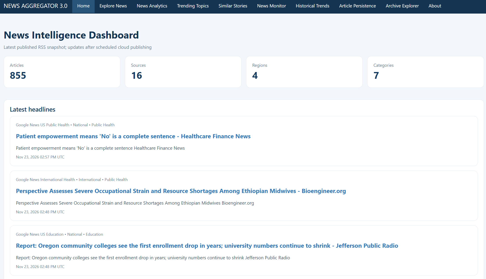
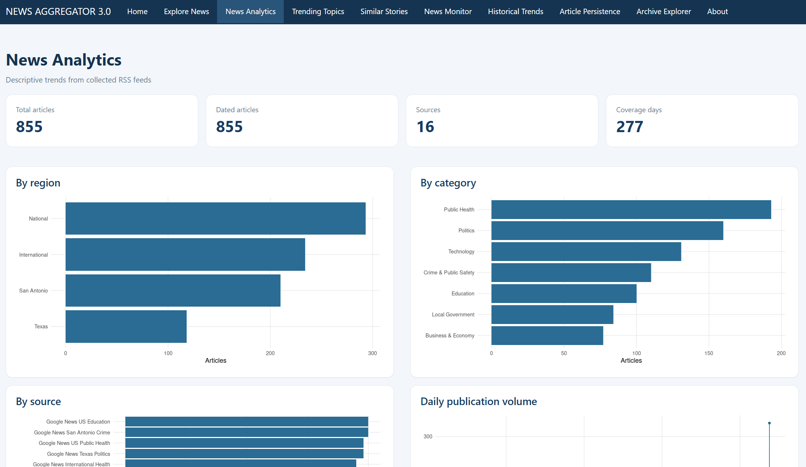
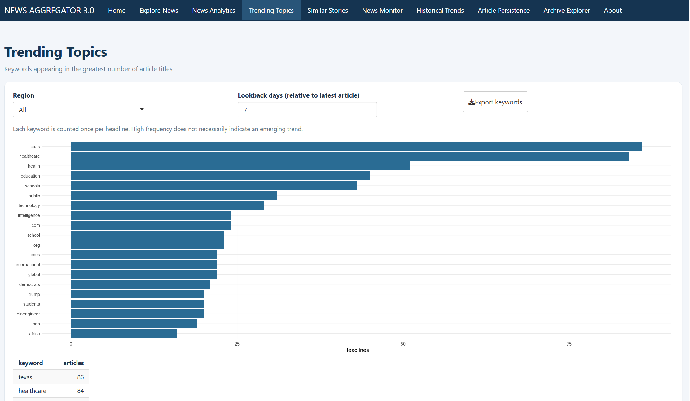
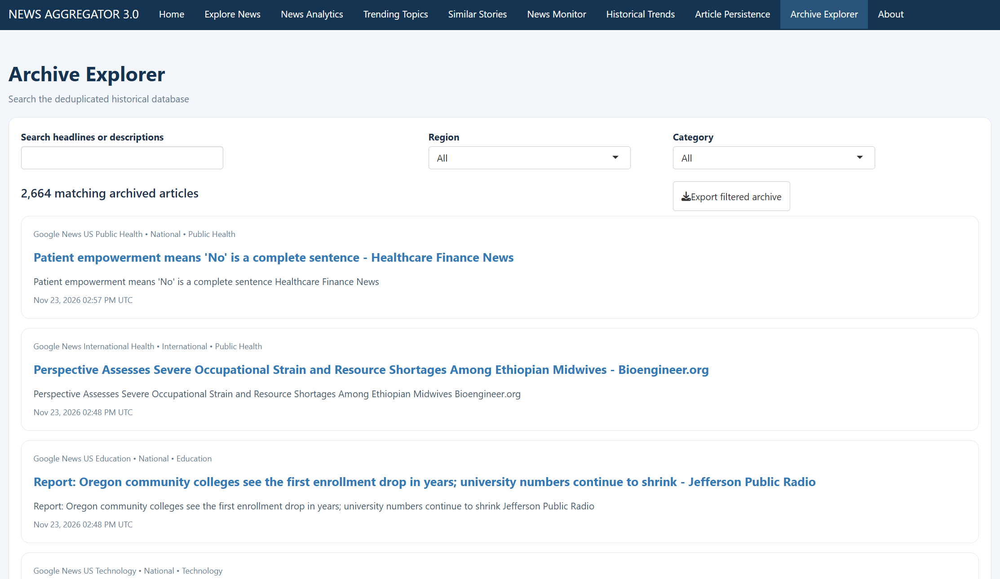

# News Intelligence Aggregator 3.0

**An R-based news monitoring, historical archiving, and analytics dashboard with automated cloud publishing.**

[**Launch the live dashboard**](https://hydrocodex.shinyapps.io/news-aggregator-dashboard/) · [**View the source repository**](https://github.com/schisms17-code/news-aggregator-dashboard)

## Overview

News Intelligence Aggregator 3.0 collects articles from configured RSS feeds, processes them into structured datasets, maintains a historical archive, and presents the results in an interactive **R Shiny** dashboard. A scheduled workflow on a configured Windows computer collects and prepares updates, then publishes the latest dataset to **shinyapps.io**.

The dashboard is designed for desktop and tablet use, including iPad Safari. It provides a transparent view of collected news rather than a claim to represent all published news.

## Live dashboard

## Dashboard Preview

### Home Dashboard


### News Analytics


### Trending Topics


### Historical Archive


**[Open News Intelligence Aggregator 3.0](https://hydrocodex.shinyapps.io/news-aggregator-dashboard/)**

The hosted dashboard serves the **most recently deployed dataset**. Refreshing the browser does **not** trigger RSS collection. New articles appear after the separate collection and cloud-publishing workflow completes successfully.

## Features

- **RSS ingestion:** Collect articles from configurable news feeds.
- **Structured processing:** Prepare article records for exploration and analysis.
- **Historical archiving:** Preserve accumulated articles alongside the latest snapshot.
- **Interactive exploration:** Search, filter, and inspect collected articles.
- **News analytics:** Explore patterns and distributions within the collected data.
- **Trending topics:** Count normalized keywords across unique article titles.
- **Similar stories:** Surface potentially related headlines using Jaccard overlap of normalized title words; matches are approximate, not semantic verification.
- **Monitoring and history:** Inspect trends, persistence, and archived records.
- **Automated publishing:** Use a scheduled Windows workflow to collect data and redeploy the cloud application.
- **Responsive design:** Support smaller screens and touch navigation, including iPad.

### Dashboard sections

| Section | Purpose |
| --- | --- |
| Home | Overview metrics, recent headlines, and trending keywords |
| Explore News | Search and filter collected articles |
| News Analytics | Examine distributions and article patterns |
| Trending Topics | Explore frequently occurring headline terms |
| Similar Stories | Screen for overlapping headline language |
| News Monitor | Monitor the collected news snapshot |
| Historical Trends | Explore patterns across saved history |
| Article Persistence | Examine recurring article/topic signals |
| Archive Explorer | Browse historical article records |
| About | Review methods, data sources, and refresh behavior |

## Architecture

```text
Configured RSS feeds
        |
        v
R collection and processing scripts
        |
        +--> Latest article snapshot (.rds)
        |
        +--> Historical article archive (.rds)
                    |
                    v
           R Shiny dashboard
                    |
           Scheduled cloud publish
                    |
                    v
              shinyapps.io
                    |
             Browser / iPad
```

The data pipeline and hosted dashboard are separate components. Local scheduling and publishing require a configured Windows computer, working network access, and valid deployment authorization.

## Technology

- **R** for collection, transformation, and analysis
- **Shiny** for the interactive web application
- **RSS** as the article ingestion format
- **RDS** files for processed snapshots and historical records
- **Windows Task Scheduler** for scheduled execution
- **rsconnect / shinyapps.io** for cloud deployment
- **Git and GitHub** for version control and portfolio documentation

See [dependencies](docs/DEPENDENCIES.md) for the project's package details.

## Repository guide

```text
news-aggregator-dashboard/
├── R/                                  # Collection, cleaning, archive, and publishing scripts
├── config/                             # News sources and category configuration
├── dashboard/
│   └── app.R                           # Shiny dashboard
├── docs/
│   ├── DATA_DICTIONARY.md
│   ├── DEPENDENCIES.md
│   └── METHODOLOGY.md
├── scripts/                             # Supporting setup/collection scripts
├── initialize_project.R
├── run_news_collection.R
├── run_news_collection.bat
├── run_news_collection_and_publish.bat  # Local scheduled workflow entry point
└── README.md
```

The local `deployment/` directory, runtime logs, backups, and generated datasets are intentionally excluded from Git. The repository documents the code and workflow without requiring historical article data to be committed.

## Getting started locally

**Prerequisites:** R, RStudio (recommended), the packages required by the scripts, internet access for RSS collection, and a local project directory.

1. Clone the repository:

   ```bash
   git clone https://github.com/schisms17-code/news-aggregator-dashboard.git
   cd news-aggregator-dashboard
   ```

2. Review `config/news_sources.csv`, `config/news_categories.csv`, and [dependency documentation](docs/DEPENDENCIES.md).

3. In RStudio, open the project directory and run the collection workflow to create the required local data files. The project includes `run_news_collection.R` and supporting scripts under `R/` and `scripts/`. Confirm the expected input/output paths before running, as the dashboard requires generated datasets that are not stored in Git.

4. Once the latest and archive RDS files exist in the expected locations, launch the dashboard from the **RStudio Console**:

   ```r
   shiny::runApp("dashboard", launch.browser = TRUE)
   ```

**Note:** The public hosted dashboard is the easiest way to explore the application without configuring the local collection pipeline.

## Automated collection and deployment

The Windows-based workflow uses `run_news_collection_and_publish.bat` and R publishing scripts under `R/`. On the configured computer, a scheduled task can collect and process RSS articles, synchronize the deployment dataset, and publish the Shiny app to shinyapps.io.

Cloud deployment requires an authorized `rsconnect` account configured locally. **Do not commit tokens, passwords, account secrets, generated deployment bundles, or local credential files.** Review the scripts and `git status` before publishing repository changes.

## Analytical methods and limitations

- **Source coverage:** Results reflect the configured RSS feeds and successfully collected items, not the full universe of news coverage.
- **Trending terms:** Keywords are counted using unique article titles, so results are indicators of headline frequency rather than measured public interest.
- **Similar-story screening:** Jaccard overlap of normalized title words can surface related headlines but may miss paraphrases or produce false positives.
- **Refresh timing:** The hosted app reflects the most recently published snapshot; scheduled updates depend on the local collector, network, and deployment succeeding.
- **Interpretation:** News counts and keyword patterns are descriptive and should not be treated as causal evidence or independent fact-checking.

See [methodology](docs/METHODOLOGY.md) and [data dictionary](docs/DATA_DICTIONARY.md) for further detail.

## Portfolio skills demonstrated

**Data engineering:** RSS ingestion, data preparation, repeatable file-based workflows, and historical archiving.

**Analytics:** Descriptive summaries, text normalization, keyword frequency analysis, and similarity screening.

**Application development:** Interactive Shiny dashboard, responsive UI, and user-focused exploration tools.

**Operations:** Windows task automation, deployment validation, cloud publishing, and Git-based version control.

## Project status

**Version:** 3.0 — deployed, with an iPad-compatible interface and a configured scheduled collection/publishing workflow. Actual freshness depends on the latest successful scheduled run.

**Live app:** https://hydrocodex.shinyapps.io/news-aggregator-dashboard/

**Source:** https://github.com/schisms17-code/news-aggregator-dashboard
